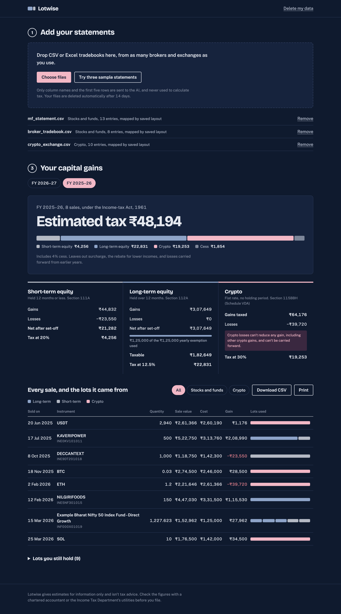

# Lotwise

Capital gains for Indian stocks, mutual funds and crypto, from any broker's export.

[](https://github.com/tttamannaanand/Lotwise-AWS/actions/workflows/ci.yml)
[](LICENSE)


**Live app:** https://7rml52kocf.execute-api.us-east-1.amazonaws.com



Upload tradebooks from as many brokers and exchanges as you use. Lotwise reads the columns with AI (Amazon Bedrock), matches every sale to the purchase lots it came from (FIFO), and applies India's capital gains rules for the financial year: equity short-term vs long-term with the ₹1.25 lakh exemption, and the flat-rate crypto (VDA) regime where losses can't be set off.

Hackathon entry: **Commercial potential** category, **Startup** lane. Tags: `#commercial-potential` `#startup`.

## How it works

```
Browser (React, served from S3 by a small web Lambda)
   │  CSV / Excel converted to CSV in the browser
   ▼
API Gateway (HTTP API) ──► web Lambda (GET /, static files)
   │
   └──────────────────────► API Lambda (Python 3.12)
                             ├─ mapper.py     header fingerprint → saved template?
                             │                 no → Amazon Bedrock proposes a column mapping
                             │                      from headers + 5 sample rows only
                             │                 Bedrock unavailable → keyword matching
                             ├─ normalize.py  applies the confirmed mapping to every row (Decimal maths)
                             ├─ engine.py     FIFO lot matching, ST/LT split, set-off rules, tax estimate
                             └─ tax_rules.py  rates versioned by financial year
                           S3        raw uploads + normalized trades (auto-deleted after 14 days)
                           DynamoDB  import metadata (TTL) + shared mapping templates
```

**The AI never does maths.** It only proposes which column means what. The user confirms the mapping on screen, and deterministic code calculates everything. Each confirmed mapping is saved as a template keyed by a fingerprint of the header row (column names only, no trade data), so the next person uploading a file from the same broker gets an instant import with no AI call. The importer gets better with every user.

The website and API share one API Gateway URL. Hosting doesn't use CloudFront, because new AWS accounts can't create distributions until they're verified, so the stack works on a brand-new account.

## Tax rules implemented (FY 2025-26 and FY 2026-27)

| | Listed equity and equity MFs | Crypto (VDA) |
|---|---|---|
| Holding period | Long-term if held more than 12 months | No distinction |
| Rate | 20% short-term; 12.5% long-term above ₹1.25 lakh per year | Flat 30% |
| Costs deductible | Purchase cost + brokerage (STT excluded) | Purchase cost only |
| Losses | ST losses offset ST and LT gains; LT losses offset LT gains only | Never set off, not even against other crypto |
| Swaps | n/a | Crypto-to-crypto trades are taxable transfers of the coin given up |

Plus 4% health and education cess. Rates live in `backend/src/tax_rules.py`; a Budget change means adding a year entry, not rewriting the engine. The Income-tax Act, 2025 applies from FY 2026-27 with renumbered sections, which the report labels accordingly.

**Not handled (shown as warnings where relevant):** the 31 Jan 2018 grandfathering rule, intraday and F&O (business income), debt funds and other assets, surcharge, rebates, and losses carried forward from earlier years. FY 2024-25 is not configured because rates changed mid-year.

## Run it locally (no AWS needed)

```bash
# Terminal 1: API on http://localhost:8787 (keyword matching, local file storage)
cd backend
python3 local_server.py

# Terminal 2: website on http://localhost:5173
cd frontend
npm install
npm run dev
```

Click **Try three sample statements**, then **Import all 3 files**. Expected result for FY 2025-26: estimated tax ₹48,194.

## Development

```bash
pip install -r requirements-dev.txt
pytest -q backend/tests     # 17 tests: hand-verified tax figures, FIFO edge cases, simulated Bedrock replies
ruff check . && ruff format --check .
```

CI runs these plus a frontend build, `npm audit` and `cfn-lint` on the SAM template, on every push and pull request.

## Deploy to AWS

### Prerequisites

- AWS CLI v2, configured with credentials for your account (`aws configure` or SSO)
- AWS SAM CLI
- Node.js 18+ and npm

### 1. Turn on a Bedrock model

1. Open the Amazon Bedrock console in the region you'll deploy to (us-east-1 has the widest model choice).
2. Pick a fast, inexpensive Claude model from the Model catalog (a Haiku model is plenty for column mapping).
3. Open it in the Playground and send one message. This completes any first-use access steps for your account.
4. Copy the **inference profile ID** (from *Cross-region inference*), for example something starting with `us.`, `apac.` or `global.anthropic.claude-haiku-...`. Use the exact string the console shows.

### 2. Deploy

```bash
BEDROCK_MODEL_ID="paste-the-id-here" AWS_REGION=us-east-1 ./deploy.sh
```

This creates the stack, builds the website, uploads it, and prints the public **Website URL**. First deploy takes a few minutes. Re-run the same command after any code change.

To remove everything: `./destroy.sh`.

### If AI mapping isn't working

The app falls back to keyword matching and shows "Matched by column names" with a note. Check CloudWatch logs for the `ApiFunction`. The usual causes are a wrong model ID, a region where that model isn't offered, or model access not yet granted.

## Project structure

```
backend/src/        Lambda code (no third-party dependencies)
backend/tests/      pytest suite
backend/local_server.py
frontend/           React + Vite website (public/samples has the demo files)
samples/            synthetic tradebooks in three different formats
template.yaml       AWS SAM infrastructure
deploy.sh, destroy.sh
```

## Privacy and security notes

- No accounts: each browser gets a random workspace ID. Anyone with that ID could read that workspace's results, so this is suitable for a demo, not for production use with real financial data. Cognito sign-in is the first item on the roadmap.
- Only column names and 5 sample rows are sent to Bedrock.
- Uploads and results expire after 14 days (S3 lifecycle + DynamoDB TTL). "Delete my data" removes them immediately.
- Excel parsing uses the official SheetJS build from cdn.sheetjs.com (the npm `xlsx` package is unmaintained and has known advisories). `npm audit` is clean and enforced in CI.

## Roadmap

Sign-in with Cognito, PDF statements (CAMS/KFintech CAS), direct broker API sync, ITR-ready Schedule 112A and Schedule VDA exports, TDS (1%) reconciliation for crypto, grandfathering, carry-forward losses across years, year-round tax-loss alerts, and an accountant plan for managing many clients.

## License

[MIT](LICENSE). Lotwise gives estimates for information only and isn't tax advice.
